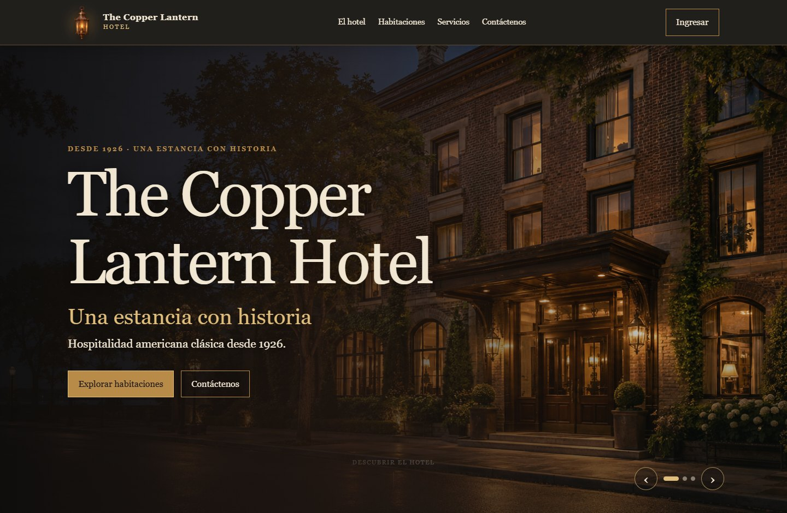
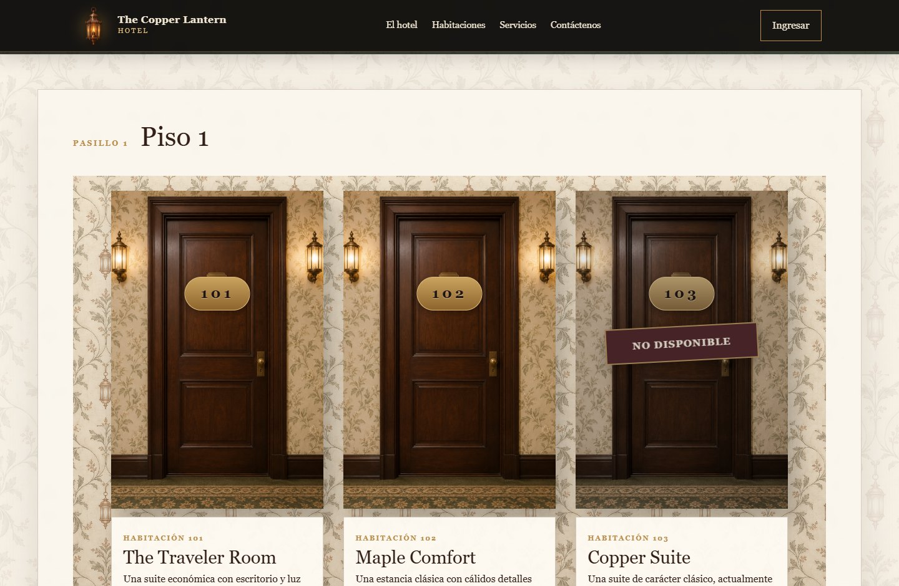
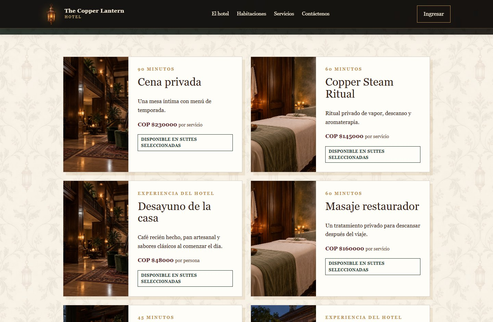
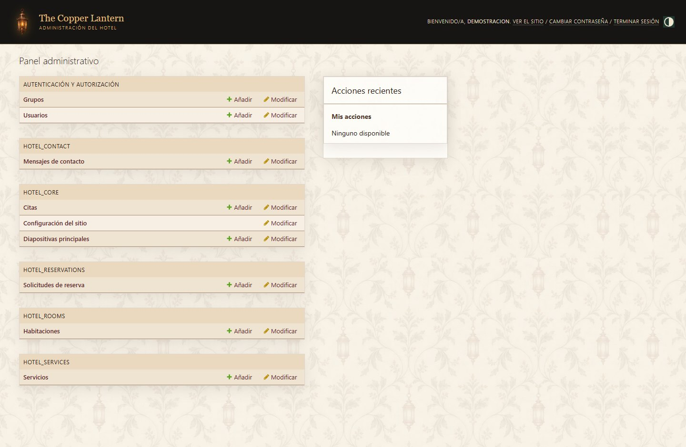

# The Copper Lantern Hotel

Sitio web y panel administrativo de un hotel boutique ficticio, desarrollados con Django y MariaDB como proyecto académico del SENA.

Desarrollado por [Juan Esteban Maya · @Yojemr](https://github.com/Yojemr).



El sitio permite explorar habitaciones y servicios, enviar solicitudes de reserva y contactar al hotel. Desde el panel se gestionan el catálogo, los contenidos de portada y las solicitudes. Las reservas son solicitudes de demostración y el sistema no procesa pagos.

## Galería

| Habitaciones | Servicios |
| --- | --- |
|  |  |



## Ejecutar en local

Se requiere **Python 3.14** y una instancia local de **MariaDB**. El proyecto se comprobó con MariaDB 11.8.9. Ejecuta los comandos desde la raíz del repositorio.

1. Crea el entorno, instala las dependencias y prepara la configuración. En Windows con PowerShell:

   ```powershell
   python -m venv .venv
   .\.venv\Scripts\python.exe -m pip install -r requirements.txt
   Copy-Item .env.example .env
   .\.venv\Scripts\python.exe -c "from django.core.management.utils import get_random_secret_key; print(get_random_secret_key())"
   ```

   En macOS o Linux usa `.venv/bin/python` y `cp .env.example .env`. Si `mysqlclient` se compila desde código fuente, instala las [dependencias de desarrollo de tu sistema](https://github.com/PyMySQL/mysqlclient#install).

2. En MariaDB, con una cuenta autorizada para crear bases y usuarios, ejecuta estas sentencias. Sustituye `CONTRASENA_LOCAL` por una contraseña propia.

   ```sql
   CREATE DATABASE copper_lantern CHARACTER SET utf8mb4 COLLATE utf8mb4_unicode_ci;
   CREATE USER 'copper_app'@'127.0.0.1' IDENTIFIED BY 'CONTRASENA_LOCAL';
   GRANT ALL PRIVILEGES ON copper_lantern.* TO 'copper_app'@'127.0.0.1';
   ```

   En `.env`, completa `DJANGO_SECRET_KEY` con el valor generado y `DB_PASSWORD` con la contraseña de MariaDB. Ajusta `DB_PORT` si la instancia usa otro puerto.

3. Aplica las migraciones, carga los datos de demostración en la base nueva y crea tu cuenta de administrador.

   ```powershell
   .\.venv\Scripts\python.exe Proyecto/manage.py migrate
   .\.venv\Scripts\python.exe Proyecto/manage.py loaddata sample_hotel
   .\.venv\Scripts\python.exe Proyecto/manage.py createsuperuser
   .\.venv\Scripts\python.exe Proyecto/manage.py runserver 127.0.0.1:8000
   ```

   Abre [el sitio](http://127.0.0.1:8000/) o [el panel de administración](http://127.0.0.1:8000/admin/). Esta configuración sirve para una demostración local.

## Arquitectura y pruebas

- `hotel_core` reúne la portada, los contenidos del sitio y los datos de demostración.
- `hotel_rooms`, `hotel_services`, `hotel_reservations` y `hotel_contact` separan las funcionalidades por dominio.
- Las plantillas de Django generan las vistas y MariaDB almacena los datos. Consulta el [modelo de datos](docs/MODELO_DATOS.md).

```powershell
.\.venv\Scripts\python.exe Proyecto/manage.py check
.\.venv\Scripts\python.exe Proyecto/manage.py makemigrations --check --dry-run
.\.venv\Scripts\python.exe Proyecto/manage.py test hotel_core hotel_rooms hotel_services hotel_reservations hotel_contact
```

La suite crea y elimina su propia base temporal `test_copper_lantern`. Para ejecutarla con el usuario de la guía, concede permisos sobre esa base con `GRANT ALL PRIVILEGES ON test_copper_lantern.* TO 'copper_app'@'127.0.0.1';`.
